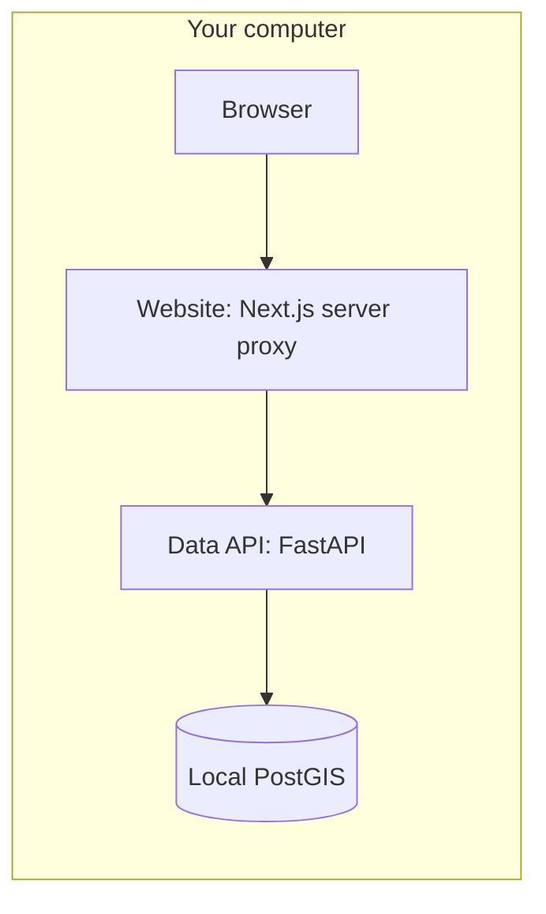
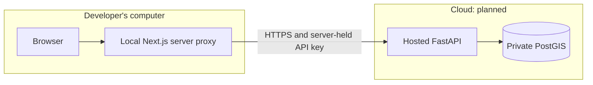
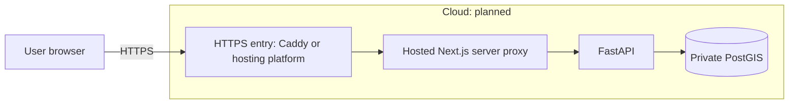
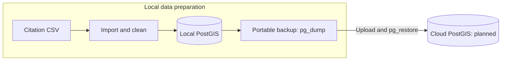

# Lucky Parking workflow slides

Status as of October 19, 2026. Cloud diagrams show proposed architecture.
The fully local workflow is implemented and tested with a 200,000-row sample.

## Slide 1 — Deployment workflows

- One shared website and data service support three hosting options.
- Fully local: implemented and verified with sample data.
- Local website with cloud data: architecture and environment template prepared.
- Fully hosted: architecture and environment template prepared.
- Current implementation work focuses on the fully local workflow.

Presenter note: `apps/web` is the main Lucky Parking website. `apps/data-service`
contains FastAPI, PostGIS loading/query tools, and a separate diagnostic explorer.
The older Express/MongoDB API is outside these three workflows.

## Slide 2 — Local website + local database

**Status: implemented; verified with a 200,000-row sample.**

- CSV loading and all application services run on one computer.
- The main website now queries local PostGIS through FastAPI.
- Validation passed: 62 Python tests and 21 end-to-end smoke checks.
- The map shows up to 1,000 markers; totals include all matching loaded records.
- Remaining: full dataset import and representative performance checks.

Presenter note: local hosting still uses Mapbox for the basemap and external
geocoding. It requires internet access and a public Mapbox token. The sample
does not represent the full city dataset. Existing CSV files can be mounted in
place rather than copied.

## Slide 3 — Local website + cloud database

**Status: planned; configuration template only.**

- Developers run the website without importing the full CSV.
- The local website server queries a shared hosted API.
- `PARKING_API_URL` selects the service; `PARKING_API_KEY` stays on the server.
- Existing progress: shared proxy implementation and an environment template.
- Remaining: hosted API/database, restore validation, keys, and HTTPS tests.

Presenter note: this is a target architecture. No cloud endpoint has been
deployed or verified. The browser calls its own local website route; it never
connects directly to PostgreSQL or receives the data-service API key.

## Slide 4 — Hosted website + cloud database

**Status: planned; production integration and validation remain.**

- Users open the public website; no local installation is needed.
- Hosted Next.js calls FastAPI while PostgreSQL stays private.
- Earlier Docker/Caddy deployment drafts provide a starting point.
- Website and data service can share one VPS or use separate hosts.
- Remaining: supported database image, hosting, domains/TLS, recovery tests,
  monitoring, and a data-refresh strategy.

Presenter note: a cloud diagram does not mean the services are already live.
Production sizing, traffic capacity, and uptime have not been established.

## Slide 5 — Database preparation and cloud handoff

**Status: local sample import verified; cloud handoff unverified.**

- A local database build can seed either cloud workflow.
- Upload a `pg_dump` backup plus application code and Docker files.
- Restore into cloud PostGIS and persist its live database volume.
- Cloud restore and recovery tests remain pending.
- The Socrata incremental-refresh script remains experimental and unscheduled.

Presenter note: the transferable artifact is a PostgreSQL backup, not a live
database directory. Restoring also takes time and disk space. Routine website
requests do not reload the CSV. The refresh probe currently inserts missing
tickets; changes to existing tickets and its early-stop behavior need further
validation before scheduled production use.

## Source references

- [Current workflows](../../../apps/data-service/deploy/README.md)
- [Local workflow](../../../apps/data-service/deploy/local/README.md)
- [Local website with cloud data](../../../apps/data-service/deploy/local-web-cloud-data/README.md)
- [Fully hosted workflow](../../../apps/data-service/deploy/cloud/README.md)
- [Citation API contract](../../../apps/data-service/api/README.md)
- Local implementation test results recorded in this chat on October 19, 2026.
